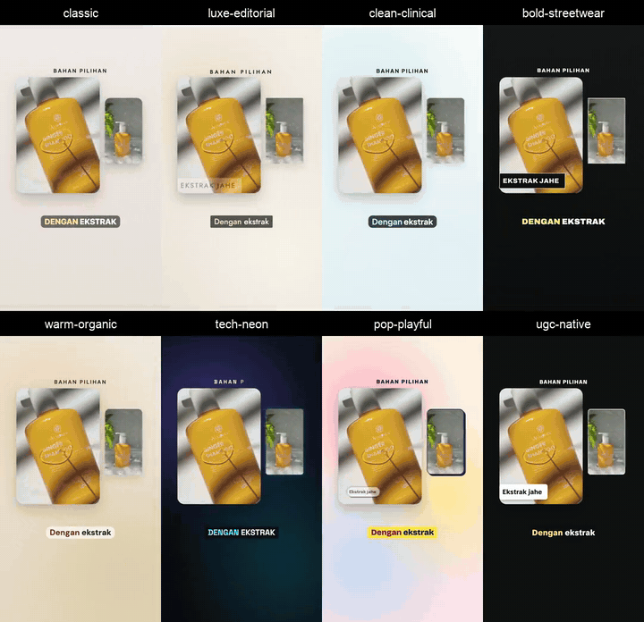

# vertical-product-ads

Buat iklan produk 9:16 untuk TikTok, Reels, dan Shorts dari foto atau footage kreator melalui coding agent Anda.

Skill ini menangani konsep, naskah, suara, musik, animasi, dan render MP4.
Skill berjalan di dalam agen, bukan aplikasi editor video terpisah.

[English](README.md) · [Galeri](docs/showcase.id.md) · [Panduan penggunaan](docs/guide.id.md)

## Dua skill, dua tugas

- `ad-concept` menyusun hook, naskah, dan adegan untuk Anda setujui.
- `vertical-product-ads` membuat konsep yang disetujui menjadi video, memeriksa pratinjau, dan mengekspor MP4 final.

Pakai keduanya atau pasang salah satu. Skill ini bekerja di agen yang mendukung `SKILL.md`,
termasuk Claude Code, Codex, Cursor, Amp, dan Cline.

## Contoh hasil

Footage kreator yang sama, dirender dalam delapan look dengan picture-in-picture, split screen,
kolase, dan callout produk. Klik pratinjau untuk video lengkap dengan suara.

<a href="media/ugc-layouts.mp4"></a>

Footage oleh [@hanie.ugc.creator](https://www.tiktok.com/@hanie.ugc.creator/video/7467561053971369223),
dipakai dengan izin. Video memakai b-roll dengan voice-over, bukan dialog kreator.
[Lihat semua contoh, look, dan layout](docs/showcase.id.md).

## Mulai cepat

Siapkan Node.js 20+, Python 3.9+, dan FFmpeg. [Detail setup](docs/guide.id.md#instalasi).

**1. Pasang kedua skill.**

```bash
npx skills add tomimandalaputra/vertical-product-ads --skill '*' -y
```

**2. Jalankan setup sekali.** Gunakan lokasi skill yang dicetak installer:

```bash
SKILL=".claude/skills/vertical-product-ads"  # Codex: .agents/skills/vertical-product-ads
"$SKILL/scripts/check_setup.sh" --with all
```

**3. Taruh brief dan aset dalam satu folder proyek, lalu minta agen:**

> Buatkan iklan produk TikTok 30 detik dari folder `ads/my-product`.
> Data produk dan klaim yang boleh dipakai ada di `brief.md`; foto ada di `assets/`.
> Pakai look warm-organic dan audio gratis untuk draf.
> Tampilkan konsep sebelum mulai produksi.

Agen menyiapkan konsep, lalu membuat pratinjau dan MP4 final setelah Anda setuju.
Untuk produksi tanpa menunggu persetujuan, awali prompt dengan **Autopilot**.

[Template brief](skills/ad-concept/templates/brief.md) ·
[Contoh prompt lain](skills/ad-concept/examples/prompts.md)

## Jenis video

| Gaya | Bahan awal |
|---|---|
| Motion | Foto produk, teks animasi, dan grafis |
| UGC | Footage kreator dengan suara bicara asli dan caption |
| Hybrid | Footage dengan motion graphics, memakai suara kreator atau voice-over |

Ada delapan look, mulai dari editorial hingga creator-native. Layout mencakup split screen,
grid, kolase, picture-in-picture, bingkai ponsel, dan callout.
[Lihat perbedaannya di galeri](docs/showcase.id.md#look-dan-layout).

ElevenLabs bersifat opsional. Musik dan efek suara bisa dibuat lokal; suara gratis memakai
edge-tts, yang ketentuan penggunaan komersialnya belum jelas.
Lihat [pilihan audio](docs/guide.id.md#suara-dan-musik).

## Dokumentasi

| Halaman | Isinya |
|---|---|
| [Panduan penggunaan](docs/guide.id.md) | Setup, persiapan aset, persetujuan konsep, audio, dan render |
| [Galeri](docs/showcase.id.md) | Contoh iklan, perbandingan look, demo layout, dan kredit |
| [Referensi teknis](docs/technical.id.md) | Pengecekan kualitas, batasan, waktu render, dan struktur repo |

## Lisensi

Skill berlisensi [MIT](LICENSE); font bawaan memakai SIL Open Font License.
Media contoh dan aset pihak ketiga memiliki ketentuan terpisah. Atribusi, termasuk teknik motion
yang diadaptasi dari product-launch-motion: [NOTICE](NOTICE).
