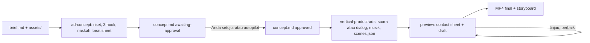

# vertical-product-ads

Dua skill agen untuk **iklan produk vertikal 9:16** (TikTok, Instagram Reels, YouTube Shorts, promo
e-commerce, iklan kecantikan/skincare): dari ide sampai MP4 siap tayang dalam satu prompt.
Versi Inggris: [README.md](README.md).

| Skill | Tugasnya |
|---|---|
| `ad-concept` | Membaca brief dan aset, meriset produk, mengusulkan 3 hook, menulis naskah dan beat sheet ke `concept.md` |
| `vertical-product-ads` | Memproduksi konsep yang disetujui menjadi MP4: suara, musik, animasi, pengecekan kualitas, render |

Bisa dipakai di agen apa pun yang membaca skill `SKILL.md`: Claude Code, Codex, Cursor, Amp, Cline,
dan lainnya.

**Daftar isi**
- Memakai: [Mulai cepat](#mulai-cepat) · [Cara kerja](#cara-kerja) · [Menyiapkan bahan](#menyiapkan-bahan) · [Contoh prompt](#contoh-prompt) · [Gaya video](#gaya-video) · [Suara dan musik](#suara-dan-musik) · [Durasi](#durasi)
- Hasil: [Jaminan kualitas](#jaminan-kualitas) · [Batasan](#batasan) · [Kecepatan terukur](#kecepatan-terukur)
- Teknis: [Kebutuhan sistem](#kebutuhan-sistem) · [Struktur repo](#struktur-repo) · [Lisensi](#lisensi)

---

## Mulai cepat

**1. Pasang skill**
```bash
npx skills add tomimandalaputra/vertical-product-ads --skill '*' -y           # kedua skill, tanpa pertanyaan
npx skills add tomimandalaputra/vertical-product-ads                          # pilih skill + agen secara interaktif
npx skills add tomimandalaputra/vertical-product-ads --skill ad-concept       # hanya satu skill
```

**2. Jalankan pengecekan setup sekali.** Skrip ini memasang Chromium (Playwright) dan Python numpy bila
belum ada. Folder skill tergantung agen: `.claude/skills/` untuk Claude Code, `.agents/skills/` untuk
Codex dan sebagian besar agen lain (installer mencetak path-nya).
```bash
SKILL=.claude/skills/vertical-product-ads        # atau .agents/skills/vertical-product-ads
$SKILL/scripts/check_setup.sh                    # inti
$SKILL/scripts/check_setup.sh --with all         # + suara gratis (edge-tts) + transkripsi lokal (faster-whisper)
```

**3. Coba tanpa aset dan tanpa kunci API** (opsional, memastikan semuanya jalan):
```bash
cp -r $SKILL/examples/minimal my-ad
$SKILL/scripts/make.sh my-ad preview              # contact sheet + draf
$SKILL/scripts/make.sh my-ad final my-ad/out.mp4  # MP4 final + storyboard
```

**4. Minta agen membuat iklan.** Taruh bahan di satu folder, lalu tulis prompt, misalnya:
> Buatkan iklan dari folder `iklan/glowa`. Brief ada di `brief.md`.

Lihat [Menyiapkan bahan](#menyiapkan-bahan) dan [Contoh prompt](#contoh-prompt).

---

## Cara kerja



Produksi tidak dimulai tanpa `concept.md` yang sudah disetujui. Ada dua mode:

| Mode | Perilaku | Cara memakai |
|---|---|---|
| **Checkpoint** (bawaan) | Agen menanyakan semua yang kurang dalam satu pesan, menulis konsep, lalu berhenti dan menampilkan 3 hook. Setelah Anda setuju (atau mengedit), baru videonya dibuat | Default |
| **Autopilot** | Agen mengasumsikan yang kurang, memilih hook sendiri, dan jalan sampai MP4. Semua asumsi (`ASSUMPTION:`) dan keputusan (`DECISION:`) dicatat di `concept.md` dan di laporan | Tulis "Autopilot" di awal prompt, atau `mode: autopilot` di `brief.md` |

---

## Menyiapkan bahan

**Brief.** Salin [`templates/brief.md`](skills/ad-concept/templates/brief.md) ke
`iklan/<nama>/brief.md` lalu isi. Bisa juga tanpa brief: tulis detailnya di prompt dan agen membuat
`brief.md` sendiri. Contoh brief terisi, satu produk fiktif dengan tiga gaya:
[motion](skills/ad-concept/examples/brief-motion.md) ·
[ugc](skills/ad-concept/examples/brief-ugc.md) ·
[hybrid](skills/ad-concept/examples/brief-hybrid.md).

**5 hal wajib** di prompt atau brief: produk (nama, varian, harga), klaim + sumbernya, CTA persis,
target + platform, lokasi aset.

**Aset per gaya.** Taruh file di `iklan/<nama>/assets/`.

| | `motion` | `ugc` | `hybrid` |
|---|---|---|---|
| **Wajib** | Foto produk ≥ 3 sudut, sisi terpendek ≥ 2000 px, latar putih/transparan, tanpa teks | Footage kreator 9:16 1080×1920, 30 fps, bicara ke kamera, audio bersih tanpa musik | Footage kreator (min. hook + testimoni) **dan** foto produk |
| **Disarankan** | Logo, warna brand (hex), close-up tekstur ≥ 1600 px, satu foto per shade | 2–4 b-roll 3–6 dtk (putar produk, cara pakai, tekstur), 1 packshot untuk end card | b-roll, tekstur, foto shade |
| **Suara** | VO: ElevenLabs atau gratis (edge-tts) | Suara kreator | Suara kreator |
| **Izin** | Foto model, jika ada | Izin tampil kreator | Keduanya |

Before/after, rating, dan testimoni hanya dipakai jika asli.

**Untuk `ugc` dan `hybrid`:** kirim [shot list kreator](skills/ad-concept/templates/creator-shot-list.md)
sebelum rekaman. Isinya kalimat per take, setelan HP, cahaya, dan jeda antar kalimat.

Spesifikasi lengkap: [`references/intake.md`](skills/ad-concept/references/intake.md).

---

## Contoh prompt

Daftar lengkap (setiap gaya × mode, dengan dan tanpa `brief.md`, plus prompt revisi):
[`examples/prompts.md`](skills/ad-concept/examples/prompts.md).

**Dengan `brief.md`** (detail ada di file):

| Gaya | Prompt |
|---|---|
| `motion` | *Buatkan iklan dari folder `iklan/glowa`. Brief ada di `brief.md`.* |
| `ugc` | *Buatkan iklan UGC dari folder `iklan/glowa`. Brief di `brief.md`, footage kreator di `assets/`.* |
| `hybrid` | *Autopilot: buat iklan dari folder `iklan/glowa`, brief di `brief.md`.* |

**Tanpa `brief.md`** (semua detail di prompt; gaya motion, checkpoint, audio gratis):
> Buatkan iklan TikTok 30 detik gaya motion untuk **Glowa Lip Serum**, serum bibir berwarna tipis
> (3 shade: Rose, Peach, Berry; Rp89.000 di TikTok Shop). Foto ada di `iklan/glowa/assets/`:
> packshot putih 3 sudut, 1 close-up tekstur, 3 foto shade. Target: perempuan 20–30 tahun yang
> bibirnya cepat kering. Klaim: "lembap hingga 24 jam" (uji internal Glowa, 30 responden). Warna
> brand #C2416B. CTA: "Cek keranjang kuning". Voice-over perempuan bahasa Indonesia; suara dan
> musik gratis.

**Setelah konsep muncul:**

| Untuk | Prompt |
|---|---|
| Menyetujui | *Setuju hook #2, lanjut produksi.* |
| Mengubah | *Hook #1 tapi kalimatnya lebih pendek, dan jangan tampilkan harga.* |
| Revisi video | *Teks klaim di detik 18 terlalu kecil, perbaiki lalu render ulang.* |

---

## Gaya video

| Gaya | Tampilannya | Butuh |
|---|---|---|
| `motion` (bawaan) | Satu bentuk membulat yang berubah antar foto, kartu, teks, dan CTA, mengikuti ketukan musik | Foto produk |
| `ugc` | Kreator berbicara ke kamera; footage memimpin; caption muncul kata demi kata | Footage dengan suara bicara |
| `hybrid` | Hook dan testimoni dari kreator, diselingi kartu produk, bukti, dan CTA bergaya motion | Footage + foto |

**Cara ganti gaya:** isi `style:` di `brief.md`, atau tulis di prompt (*"Ubah iklan `iklan/glowa`
jadi hybrid, pakai `review.mp4` untuk hook."*). Agen memperbarui `concept.md`; pada mode
checkpoint ia meminta persetujuan ulang.

Penjelasan tiap gaya untuk pemula: [`references/styles.md`](skills/ad-concept/references/styles.md).

---

## Suara dan musik

Iklan lengkap bisa dibuat **tanpa kunci ElevenLabs**. Untuk memakai ElevenLabs, isi
`ELEVENLABS_API_KEY` di environment atau di file `.env` pada folder proyek (atau folder induknya).

| Bagian | ElevenLabs | Gratis | Catatan lisensi |
|---|---|---|---|
| Voice-over | `vo.engine: "elevenlabs"` | `vo.engine: "edge"` (edge-tts, perlu internet) | edge-tts adalah klien tidak resmi layanan baca-teks Edge milik Microsoft. Ketentuannya untuk iklan berbayar tidak jelas: pakai untuk draf, atau terima risikonya |
| Musik | `music.prompt` | `music.synth` (musik prosedural lokal) atau file musik berlisensi | Musik synth dibuat di komputer Anda, sepenuhnya milik Anda |
| Transkripsi footage | `dialogue.transcriber: "elevenlabs"` | `"whisper"` (faster-whisper, offline) | Lokal, tanpa unggah. `"auto"` memakai ElevenLabs bila bisa, selain itu whisper |

Lisensi ElevenLabs mengikuti ketentuan paket Anda.

---

## Durasi

| Aturan | Nilai |
|---|---|
| Bawaan | 30 detik |
| Diizinkan | 15–60 detik |
| Di atas 34 detik | Peringatan; konsep wajib menulis alasannya |
| Di atas 60 detik | Ditolak |
| Hook | Dalam 3 detik pertama |
| CTA | Ditahan 3–5 detik |
| Per platform | TikTok 30 dtk · Reels 30 dtk (+ versi 15 dtk opsional sebagai proyek terpisah) · Shorts 30 dtk |

Angka 21–34 detik (TikTok) dan di bawah 15 detik (Meta) berasal dari sumber sekunder:
[`references/duration-and-platforms.md`](skills/ad-concept/references/duration-and-platforms.md).

---

## Jaminan kualitas

Setiap iklan melewati pengecekan otomatis. Kalau ada yang gagal, build berhenti dan agen harus
memperbaiki adegannya; tidak ada pengecekan yang boleh dilewati.

| Pengecekan | Yang dijaga |
|---|---|
| Safe zone | Setiap kata, caption, chip, dan CTA berada di x 84–930, y 250–1460 (tidak tertutup tombol aplikasi), dicek di **setiap frame** |
| Tata letak | Tidak ada teks yang bertumpuk; tidak ada band kosong (bentuk yang tampil tanpa gambar atau isi) |
| Dialog footage | Potongan tidak jatuh di tengah kata; segmen tidak saling tumpang |
| Format | Isi `scenes.json`, aset, gaya, dan durasi sesuai aturan |
| Audio | Master −14 LUFS (±0,6), puncak ≤ −0,5 dBFS pada file akhir |
| Render | Tidak ada patahan di sambungan antar potongan render |

Ditambah dua tahap tinjau sebelum final: **contact sheet** (satu gambar per ketukan, diberi cap waktu)
dan **draf setengah ukuran dengan suara**.

Ciri hasilnya:
- **Motion blur nyata:** 4 subframe per frame, shutter 180°, 30 fps.
- **Suara dan musik terkunci:** waktu tiap kata diukur; kata kunci jatuh di ketukan musik; teks muncul
  pada kata yang menyebutnya.
- **Sound design sintetis** sesuai nada lagu; musik mengecil saat ada suara.
- **Adegan motion tanpa potongan:** satu bentuk berubah menjadi kartu, lingkaran, tiga pita, atau layar penuh.

---

## Batasan

- **Tidak membuat presenter avatar/AI** dan tidak menyutradarai live action. Footage kreator harus direkam sendiri.
- **B-roll (footage tanpa bicara) dibisukan.**
- **Agen tidak bisa menonton video.** Ia bekerja dari transkrip, snapshot, dan deskripsi Anda,
  termasuk untuk iklan referensi.
- **Transkrip dari pengenalan suara bisa salah** pada nama merek; agen mengoreksi caption lewat
  `captions.fix` dan meminta Anda memeriksa.
- **Audio hanya diukur oleh agen, tidak didengar.** Dengarkan sebelum tayang.
- **Klaim produk hanya dari brief atau sumber resmi**, selalu dengan footnote. Untuk kosmetik di
  Indonesia, periksa aturan iklan BPOM.

---

## Kecepatan terukur

Apple M3 Pro, film `motion` 31 detik, 1080×1920. Kolom "Sebelum" adalah film yang sama yang dibuat
dengan HTML tulisan tangan dan renderer 60 fps.

| | Sebelum | Skill ini |
|---|---|---|
| Render gambar | 219 dtk (7.440 subframe) | 71 dtk (3.720 subframe, 30 fps / 180°) |
| Master audio | 35 dtk (encode ulang video) | ~5 dtk (hanya audio) |
| Draf dengan suara | tidak ada | 12 dtk |
| Menulis film | file JS ~600 baris per iklan | satu `scenes.json` per iklan |

Uji dengan agen baru (skill dipasang lewat `npx skills add`, tanpa bantuan):

| Mode | Hasil | Prompt → MP4 |
|---|---|---|
| Checkpoint | motion 30 dtk, audio gratis | 10 m 52 d (konsep siap 1 m 13 d) |
| Autopilot | hybrid 24 dtk, footage + musik ElevenLabs | 13 m 28 d |

Cara tiap angka diperoleh: [`references/render-and-qa.md`](skills/vertical-product-ads/references/render-and-qa.md)
dan [`CHANGELOG.md`](CHANGELOG.md).

---

## Kebutuhan sistem

| Butuh | Untuk | Dipasang oleh |
|---|---|---|
| Node ≥ 20 | engine, render, pengecekan | Anda |
| ffmpeg / ffprobe | motion blur, encode, loudness, frame footage | Anda (`brew install ffmpeg` / `apt install ffmpeg`) |
| Python 3.9+ | beat grid, sintesis SFX dan musik, mix | Anda |
| Playwright + Chromium, numpy | render, audio | `check_setup.sh` |
| `edge-tts` | voice-over gratis (perlu internet) | `check_setup.sh --with edge` |
| `faster-whisper` | transkripsi footage offline | `check_setup.sh --with whisper` |
| `ELEVENLABS_API_KEY` (opsional) | voice-over, musik, transkripsi ElevenLabs | Anda |

---

## Struktur repo

| Path | Isi |
|---|---|
| `skills/ad-concept/SKILL.md` | Panduan agen konsep |
| `skills/ad-concept/references/` | Intake aset, hook dan angle, gaya, menu adegan, durasi |
| `skills/ad-concept/templates/` | `brief.md`, `concept.md`, `creator-shot-list.md` |
| `skills/ad-concept/examples/` | Contoh prompt dan brief terisi per gaya |
| `skills/vertical-product-ads/SKILL.md` | Panduan agen produksi |
| `skills/vertical-product-ads/references/` | Arahan, gaya, format `scenes.json`, sinkron VO/ketukan, safe zone, render + QA |
| `skills/vertical-product-ads/engine/` | `index.html` + `engine.js`: renderer `seek(t)` |
| `skills/vertical-product-ads/scripts/` | `make.sh` (preview/final) dan semua langkahnya |
| `skills/vertical-product-ads/schemas/` | `scenes.schema.json`, kontrak yang dicek `validate.mjs` |
| `skills/vertical-product-ads/examples/minimal/` | Film 8,5 detik tanpa aset |

---

## Lisensi

MIT, lihat `LICENSE`. Sebagian diturunkan dari
[product-launch-motion](https://github.com/AbubakrChan/product-launch-motion) (MIT); lihat `NOTICE`.
Gambar produk, footage, suara, dan musik yang Anda masukkan tetap memakai lisensinya masing-masing.
