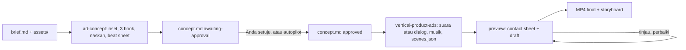

# vertical-product-ads

Dua skill agen untuk **iklan produk 9:16** (TikTok, Instagram Reels, YouTube Shorts, promo
e-commerce, dan iklan kecantikan/skincare). Versi Inggris: [README.md](README.md).

| Skill | Fungsi |
|---|---|
| `ad-concept` | Membaca brief dan aset Anda, meriset produk, mengusulkan 3 hook, menulis naskah dan beat sheet ke `concept.md`, lalu menunggu persetujuan Anda |
| `vertical-product-ads` | Membangun konsep yang sudah disetujui menjadi MP4 siap tayang: satu `scenes.json`, engine `seek(t)`, dan pipeline audio terukur |

Bisa dipakai di agen apa pun yang membaca skill `SKILL.md`: Claude Code, Codex, Cursor, Amp, Cline, dan lainnya.

## Pasang
```bash
npx skills add tomimandalaputra/vertical-product-ads                          # pilih skill + agen secara interaktif
npx skills add tomimandalaputra/vertical-product-ads --skill '*' -y           # kedua skill, tanpa pertanyaan
npx skills add tomimandalaputra/vertical-product-ads --skill ad-concept       # salah satu
npx skills add tomimandalaputra/vertical-product-ads --skill vertical-product-ads
```
Skill terpasang di folder milik agen Anda: `.claude/skills/` untuk Claude Code, `.agents/skills/`
untuk Codex dan sebagian besar agen lain (installer mencetak path-nya). Jalankan pengecekan setup
sekali dari folder skill produksi (otomatis memasang Chromium Playwright dan venv numpy bila belum ada):
```bash
.agents/skills/vertical-product-ads/scripts/check_setup.sh                # inti
.agents/skills/vertical-product-ads/scripts/check_setup.sh --with edge    # + suara gratis (edge-tts)
.agents/skills/vertical-product-ads/scripts/check_setup.sh --with whisper # + transkripsi lokal (faster-whisper)
.agents/skills/vertical-product-ads/scripts/check_setup.sh --with all
```

## Alur kerja

`vertical-product-ads` tidak akan mulai tanpa `concept.md` yang sudah disetujui.

## Checkpoint atau autopilot
- **Checkpoint (bawaan):** agen menanyakan semua yang kurang dalam satu pesan, menulis konsep, lalu
  berhenti dan menampilkan 3 hook. Anda setuju (atau mengedit), baru agen membangun videonya.
- **Autopilot:** agen mengasumsikan yang kurang, memilih hook, dan membangun dalam satu kali jalan.
  Semua asumsi dan keputusan dicatat di `concept.md` dan di laporan.

Contoh prompt:
> Buat iklan TikTok 30 detik untuk serum ini. Brief: `my-ad/brief.md`, foto di `my-ad/assets/`.
> Voice-over perempuan bahasa Indonesia.

> Autopilot: buat iklan Reels dari folder `my-ad/`, gaya ugc dengan footage saya, suara dan musik gratis.

Atau tulis `mode: autopilot` di `brief.md`.

## Yang perlu disiapkan
Salin [`skills/ad-concept/templates/brief.md`](skills/ad-concept/templates/brief.md) ke
`my-ad/brief.md`, isi, lalu taruh file di `my-ad/assets/`. Daftar cek (spesifikasi lengkap:
[`skills/ad-concept/references/intake.md`](skills/ad-concept/references/intake.md)):
- [ ] Foto produk: minimal 3 sudut, sisi terpendek ≥ 2000 px, latar putih atau transparan, tanpa teks di dalam gambar
- [ ] Nama produk, varian, harga, tempat membeli
- [ ] Klaim, masing-masing dengan sumbernya
- [ ] Tujuan iklan dan ajakan (CTA) yang persis
- [ ] Target audiens dan platform
- [ ] Logo, warna merek, font (disarankan)
- [ ] Close-up tekstur/pemakaian (disarankan); before/after dan ulasan asli, hanya jika memang asli
- [ ] Untuk `ugc`/`hybrid`: footage kreator 9:16 1080×1920, 30 fps, audio bersih, tanpa musik, izin tampil dari talent

## Gaya (style)
| Style | Tampilan | Butuh |
|---|---|---|
| `motion` (bawaan) | Satu bentuk membulat yang berubah antar foto, kartu, teks, dan CTA | Foto produk |
| `ugc` | Kreator berbicara; footage memimpin; caption kata demi kata | Footage dengan suara bicara |
| `hybrid` | Hook dari kreator, lalu kartu produk, bukti, dan CTA bergaya motion | Footage + foto |

**Cara ganti:** isi `style:` di `brief.md` atau tulis di prompt ("ganti jadi hybrid"). Agen
memperbarui `concept.md`, dan pada mode checkpoint meminta persetujuan ulang. Belum didukung:
presenter avatar atau buatan AI, dan penyutradaraan live action. B-roll (footage tanpa bicara)
dibisukan. Agen tidak bisa menonton video; ia bekerja dari transkrip dan gambar diam. Detail:
[`skills/ad-concept/references/styles.md`](skills/ad-concept/references/styles.md).

## Gratis vs ElevenLabs
| Bagian | ElevenLabs | Gratis | Catatan lisensi |
|---|---|---|---|
| Voice-over | `vo.engine: "elevenlabs"` | `vo.engine: "edge"` (edge-tts) | edge-tts adalah klien tidak resmi untuk layanan baca-teks Edge milik Microsoft; ketentuan untuk iklan berbayar tidak jelas: pakai untuk draf, atau terima risikonya. ElevenLabs: sesuai ketentuan paket Anda |
| Musik | `music.prompt` | `music.synth` (musik prosedural lokal) | Synth dibuat di komputer Anda: sepenuhnya milik Anda. File musik berlisensi juga bisa |
| Transkripsi (footage) | `dialogue.transcriber: "elevenlabs"` | `"whisper"` (faster-whisper, offline) | Lokal, tanpa unggah |

Iklan lengkap bisa dibuat tanpa kunci ElevenLabs. Untuk memakainya, isi `ELEVENLABS_API_KEY` atau
file `.env` di folder proyek atau folder induknya.

## Durasi
Bawaan 30 detik; boleh 15–60 detik; di atas 34 detik diberi peringatan dan perlu alasan; di atas 60
detik ditolak. Hook muncul dalam 3 detik pertama; CTA bertahan 3–5 detik. TikTok 30 detik, Reels 30
detik plus versi pendek 15 detik opsional yang dibuat sebagai proyek tersendiri, Shorts 30 detik.
Angka 21–34 detik (TikTok) dan di bawah 15 detik (Meta) berasal dari sumber sekunder, lihat
[`skills/ad-concept/references/duration-and-platforms.md`](skills/ad-concept/references/duration-and-platforms.md).

## Hasilnya
- **Satu bentuk, tanpa potongan** pada adegan motion: berubah jadi kartu, lingkaran, tiga pita, layar penuh.
- **Suara dan musik terkunci:** waktu per kata; tiap kalimat ditempatkan agar kata kuncinya jatuh
  tepat di ketukan musik yang terukur; teks muncul pada kata yang menyebutnya.
- **Sound design sintetis** sesuai nada lagu; musik mengecil saat ada suara; master −14 LUFS / −1 dBTP.
- **Safe zone dan tata letak dipaksakan:** setiap kata, caption, chip, dan CTA berada di x 84–930,
  y 250–1460; tidak ada teks yang bertumpuk; tidak ada band kosong. Dicek di setiap frame; build
  gagal jika melanggar.
- **Motion blur nyata:** 4 subframe per frame dengan shutter 180°, 30 fps secara bawaan.
- **Tahap tinjau bawaan:** contact sheet ketukan dan draf setengah ukuran dengan suara sebelum final.

## Coba tanpa kunci API
```bash
SKILL=.agents/skills/vertical-product-ads
cp -r $SKILL/examples/minimal my-ad
$SKILL/scripts/make.sh my-ad preview              # contact sheet + draf
$SKILL/scripts/make.sh my-ad final my-ad/out.mp4  # MP4 master + storyboard
```

## Kecepatan terukur
Apple M3 Pro, film 31 detik, 1080×1920. Kolom "Sebelum" adalah film yang sama yang dibuat dengan
film HTML tulisan tangan dan renderer 60 fps.

| | Sebelum | Skill ini |
|---|---|---|
| Render gambar | 219 dtk (7.440 subframe) | 71 dtk (3.720 subframe, 30 fps / 180°) |
| Master | 35 dtk (encode ulang video) | ~5 dtk (hanya audio) |
| Draf dengan suara | tidak ada | 12 dtk |
| Menulis film | file JS ~600 baris per iklan | satu `scenes.json` per iklan |

Cara tiap angka diperoleh: `skills/vertical-product-ads/references/render-and-qa.md`. Angka ini
diukur pada film `motion`; style footage belum diukur waktunya.

## Kebutuhan
| Butuh | Untuk |
|---|---|
| Node ≥ 20 (+ `npm install` di skill: Playwright, Ajv) | engine, render, gate |
| ffmpeg / ffprobe | motion blur, encode, loudness, frame footage |
| Python 3.9+ dengan numpy | beat grid, sintesis SFX dan musik, mix |
| `edge-tts` (`--with edge`) | voice-over gratis; perlu internet |
| `faster-whisper` (`--with whisper`) | transkripsi footage offline |
| `ELEVENLABS_API_KEY` (opsional) | voice-over, musik, transkripsi ElevenLabs |

## Struktur folder
| Path | |
|---|---|
| `skills/ad-concept/` | `SKILL.md`, `references/` (intake, hook, style, menu adegan, durasi), `templates/` (`brief.md`, `concept.md`) |
| `skills/vertical-product-ads/SKILL.md` | panduan agen produksi |
| `skills/vertical-product-ads/references/` | arahan, style, format `scenes.json`, sinkron VO/ketukan, safe zone, render + QA |
| `skills/vertical-product-ads/engine/` | `index.html` + `engine.js`: renderer `seek(t)` |
| `skills/vertical-product-ads/scripts/` | `make.sh` (preview/final) dan semua langkahnya |
| `skills/vertical-product-ads/schemas/scenes.schema.json` | kontrak yang dicek `validate.mjs` |
| `skills/vertical-product-ads/examples/minimal/` | film 8,5 detik tanpa aset |

## Lisensi
MIT, lihat `LICENSE`. Sebagian diturunkan dari
[product-launch-motion](https://github.com/AbubakrChan/product-launch-motion) (MIT); lihat `NOTICE`.
Gambar produk, footage, suara, dan musik yang Anda masukkan tetap memakai lisensinya masing-masing.
