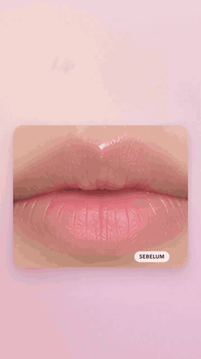
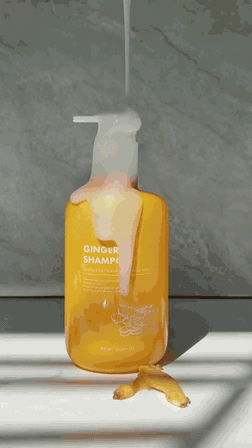
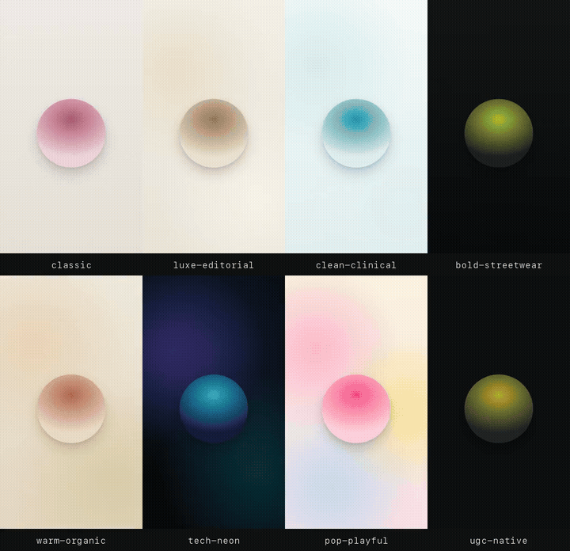
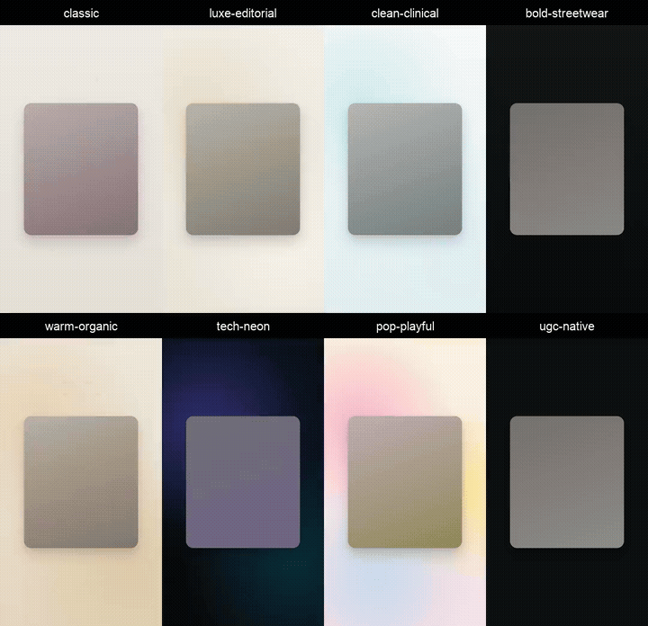
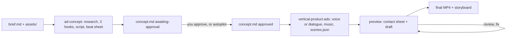

# vertical-product-ads

Two agent skills for **vertical 9:16 product ads** (TikTok, Instagram Reels, YouTube Shorts,
e-commerce promos, beauty/skincare spots): from idea to a delivery-ready MP4 in one prompt.
Indonesian version: [README.id.md](README.id.md).

| Skill | Does |
|---|---|
| `ad-concept` | Reads the brief and assets, researches the product, proposes 3 hooks, picks a style, a look and the layouts per beat, writes the script and a beat sheet into `concept.md` |
| `vertical-product-ads` | Produces the approved concept as an MP4 in one of eight looks, with split screens, grids, picture-in-picture, callouts and more: voice, music, animation, quality gates, render |

Works with any agent that reads `SKILL.md` skills: Claude Code, Codex, Cursor, Amp, Cline and others.

## Showcase

| Motion: Dior Addict Lip Glow (unofficial spec ad) | Hybrid: ginger shampoo b-roll |
|---|---|
| <a href="media/dior-lip-glow.mp4"></a> | <a href="media/ginger-shampoo.mp4"></a> |
| 31 s. AI-generated images only (model, lips, product); one shape morphs through a before/after wipe, a parallax packshot, three lip-tone bands, ingredient chips, an odometer and the end card. ElevenLabs voice and music. [MP4 with sound](media/dior-lip-glow.mp4) | 20 s TikTok ad from muted product b-roll: ElevenLabs voice, music and sound effects, an ingredient card, benefit chips, three bands that pop on their words, an end card. [MP4 with sound](media/ginger-shampoo.mp4) |

**One film, eight looks.** The same `scenes.json` rendered eight times; only `"look"` changes. A
fictional lip serum with free audio (edge-tts voice, local synth bed), no images. The project is
[`examples/look-sampler/`](skills/vertical-product-ads/examples/look-sampler/).

<a href="media/looks.mp4"></a>

**One film, every layout, eight looks.** A 20 s fictional serum ad that walks through kinetic type, a
split screen out of the card, a text mask, callouts, a comparison list, a grid that turns into a
collage under a marquee, and a phone with the shop page; again only `"look"` changes. The project is
[`examples/layout-sampler/`](skills/vertical-product-ads/examples/layout-sampler/).

<a href="media/layouts.mp4"></a>

All films have Indonesian voice-overs; the GIFs are silent. Grids with sound: [looks](media/looks.mp4), [layouts](media/layouts.mp4).

- **Dior Addict Lip Glow** is an unofficial spec ad, made to demonstrate the skills: it is not
  affiliated with, sponsored or endorsed by Christian Dior. Dior and Addict Lip Glow are trademarks
  of their owner. The 48-hour hydration claim and its footnote come from Dior's product page.
- **Ginger shampoo** footage: [@hanie.ugc.creator on TikTok](https://www.tiktok.com/@hanie.ugc.creator/video/7467561053971369223),
  used with permission. The product and brand belong to their owner; the claims are read from the
  product label. The same film as a reusable project with a fictional brand:
  [`examples/product-broll/`](skills/vertical-product-ads/examples/product-broll/).

**Contents**
- Using it: [Showcase](#showcase) · [Quick start](#quick-start) · [How it works](#how-it-works) · [Preparing material](#preparing-material) · [Example prompts](#example-prompts) · [Video styles](#video-styles) · [Looks](#looks) · [Layouts](#layouts) · [Voice and music](#voice-and-music) · [Duration](#duration)
- Results: [Quality gates](#quality-gates) · [Limits](#limits) · [Measured speed](#measured-speed)
- Technical: [Requirements](#requirements) · [Repo layout](#repo-layout) · [Licence](#licence)

---

## Quick start

**1. Install the skills**
```bash
npx skills add tomimandalaputra/vertical-product-ads --skill '*' -y           # both skills, no prompts
npx skills add tomimandalaputra/vertical-product-ads                          # pick skills + agents interactively
npx skills add tomimandalaputra/vertical-product-ads --skill ad-concept       # one skill only
```

**2. Run the setup check once.** It installs Chromium (Playwright) and Python numpy when missing.
The skill folder depends on the agent: `.claude/skills/` for Claude Code, `.agents/skills/` for Codex
and most others (the installer prints the path).
```bash
SKILL=.claude/skills/vertical-product-ads        # or .agents/skills/vertical-product-ads
$SKILL/scripts/check_setup.sh                    # core
$SKILL/scripts/check_setup.sh --with all         # + free voice (edge-tts) + local transcription (faster-whisper)
```

**3. Try it with no assets and no API key** (optional, proves everything runs):
```bash
cp -r $SKILL/examples/minimal my-ad
$SKILL/scripts/make.sh my-ad preview              # contact sheet + draft
$SKILL/scripts/make.sh my-ad final my-ad/out.mp4  # final MP4 + storyboard
```

**4. Ask your agent for an ad.** Put the material in one folder and prompt, for example:
> Make an ad from the folder `ads/glowa`. The brief is in `brief.md`.

See [Preparing material](#preparing-material) and [Example prompts](#example-prompts).

---

## How it works



Production does not start without an approved `concept.md`. Two modes:

| Mode | Behaviour | How |
|---|---|---|
| **Checkpoint** (default) | Asks everything missing in one message, writes the concept, then stops and shows 3 hooks. Builds after you approve (or edit) | Default |
| **Autopilot** | Assumes what is missing, picks the hook and runs to the MP4. Every assumption (`ASSUMPTION:`) and decision (`DECISION:`) is logged in `concept.md` and the report | Start the prompt with "Autopilot", or set `mode: autopilot` in `brief.md` |

---

## Preparing material

**Brief.** Copy [`templates/brief.md`](skills/ad-concept/templates/brief.md) to `ads/<name>/brief.md`
and fill it in. Or skip it: put the details in the prompt and the agent writes `brief.md` itself.
Filled briefs, one fictional product in three styles:
[motion](skills/ad-concept/examples/brief-motion.md) ·
[ugc](skills/ad-concept/examples/brief-ugc.md) ·
[hybrid](skills/ad-concept/examples/brief-hybrid.md).

**The 5 essentials** for a prompt or brief: product (name, variants, price), claims + sources, the
exact CTA, audience + platform, where the assets are.

**Assets per style.** Put files in `ads/<name>/assets/`.

| | `motion` | `ugc` | `hybrid` |
|---|---|---|---|
| **Required** | Product photos: ≥ 3 angles, ≥ 2000 px short side, white/transparent, no baked-in text | Creator footage 9:16 1080×1920, 30 fps, talking to camera, clean audio, no music | Creator footage (at least hook + testimonial) **and** product photos |
| **Recommended** | Logo, brand colours (hex), texture close-ups ≥ 1600 px, one photo per shade | 2–4 b-roll clips of 3–6 s (product turn, application, texture), 1 packshot for the end card | b-roll, texture, shade photos |
| **Speech** | Voice-over: ElevenLabs or free (edge-tts) | The creator's voice | The creator's voice |
| **Release** | Model photos, if any | Creator release | Both |

Before/after, ratings and testimonials only if real.

**For `ugc` and `hybrid`:** send the [creator shot list](skills/ad-concept/templates/creator-shot-list.md)
before the shoot: lines per take, phone settings, light, pauses between sentences.

Full specs: [`references/intake.md`](skills/ad-concept/references/intake.md).

---

## Example prompts

The full list (every style × mode, with and without `brief.md`, plus revision prompts) is in
[`examples/prompts.md`](skills/ad-concept/examples/prompts.md), written in Indonesian; prompts work in
any language.

**With `brief.md`** (details in the file):

| Style | Prompt |
|---|---|
| `motion` | *Make an ad from the folder `ads/glowa`. The brief is in `brief.md`.* |
| `ugc` | *Make a UGC ad from `ads/glowa`. Brief in `brief.md`, creator footage in `assets/`.* |
| `hybrid` | *Autopilot: make an ad from `ads/glowa`, brief in `brief.md`.* |

**Without `brief.md`** (everything in the prompt; motion, checkpoint, free audio):
> Make a 30-second TikTok ad, motion style, for **Glowa Lip Serum**, a sheer tinted lip serum
> (3 shades: Rose, Peach, Berry; IDR 89,000 on TikTok Shop). Photos in `ads/glowa/assets/`: white
> packshots from 3 angles, 1 texture close-up, 3 shade photos. Audience: women 20–30 whose lips dry
> out fast. Claim: "moisturised for up to 24 hours" (Glowa internal test, 30 respondents). Brand
> colour #C2416B. CTA: "Cek keranjang kuning". Female Indonesian voice-over; free voice and music.

**Once the concept is shown:**

| To | Prompt |
|---|---|
| Approve | *Hook #2 is good, go ahead.* |
| Change | *Hook #1 but shorter, and don't show the price.* |
| Revise the video | *The claim text at 18 s is too small; fix it and render again.* |

---

## Video styles

| Style | Looks like | Needs |
|---|---|---|
| `motion` (default) | One rounded shape morphing between photos, cards, text and CTA on the beat | Product photos |
| `ugc` | A creator talks to camera; footage leads; word-by-word captions | Footage with speech |
| `hybrid` | Creator hook and testimonial, with product cards, proof and CTA in the motion look between them | Footage + photos |

**Switching styles:** set `style:` in `brief.md`, or say it in the prompt (*"Make `ads/glowa`
hybrid, use `review.mp4` for the hook."*). The agent updates `concept.md`; in checkpoint mode it asks
you to approve again.

Plain-language guide to each style: [`references/styles.md`](skills/ad-concept/references/styles.md).

---

## Looks

`style` decides how the film is produced; `look` decides how it looks: fonts, palette, chip and button
shape, captions and how text enters. Eight looks ship with the skill, fonts included (SIL Open Font
License, no download). Any look works with any style.

| Look | For | Type | Text enters |
|---|---|---|---|
| `classic` (default) | Anything; the Dior film above | Georgia + system sans | soft blur |
| `luxe-editorial` | Fragrance, jewellery, premium beauty, fashion | Bodoni Moda + Jost | rising from a mask |
| `clean-clinical` | Skincare actives, pharmacy, supplements | Plus Jakarta Sans | wipe |
| `bold-streetwear` | Sneakers, streetwear, energy drinks, fitness | Anton capitals + Archivo | hard cut and slam |
| `warm-organic` | Herbal, jamu, coffee, food, hair and body care | Fraunces + DM Sans | soft blur |
| `tech-neon` | Gadgets, audio, apps | Space Grotesk + JetBrains Mono | typed on |
| `pop-playful` | Snacks, drinks, toys, Gen-Z beauty | Bricolage Grotesque + Rubik | bouncy pop |
| `ugc-native` | Creator footage (`ugc`, `hybrid`) | TikTok Sans | cut, outlined captions |

Each look also comes with direction for the agent: corner radius, pace, music and sound-effect
choices ([`references/looks.md`](skills/vertical-product-ads/references/looks.md)). Brand colours
go over any look.

**Choosing a look:** set `look:` in `brief.md`, or say it (*"Use the tech-neon look, keep the brand
colours."*). Left blank, the agent picks one from the product category and writes why in
`concept.md`. Switching later changes one line in `scenes.json`; the voice and music are reused.
Plain-language guide: [`references/looks.md`](skills/ad-concept/references/looks.md).

---

## Layouts

Every beat can use its own layout, and the look styles it. Panels grow out of the morphing shape and
merge back into it, so the film still never cuts; footage works inside panels too.

| Layout | Good for |
|---|---|
| Split screen | Before/after, ours vs. the usual, day 1 vs. day 7 |
| Grid, collage | Shades, sizes, a bundle; lifestyle moments as tilted polaroids |
| Picture-in-picture | The creator keeps talking over b-roll |
| Card stack | Reviews or features, one card each |
| Phone | The shop page or a screen recording, CTA under it |
| Text mask | The product or footage inside the brand word |
| Callouts | Ingredients or features pointed out on the product |
| Comparison list | ✓/✗ rows landing on their words |
| Marquee | A running promo band |
| Kinetic type, editorial grid | Words alone; one big and one small picture with big type |

The concept agent picks 2–4 per film from the scene menu and names them in the beat sheet; ask for
one by name (*"Use a split screen for before/after and a phone for the CTA."*). Recipes and rules:
[`references/layouts.md`](skills/vertical-product-ads/references/layouts.md).

---

## Voice and music

A full ad needs **no ElevenLabs key**. To use ElevenLabs, see [ElevenLabs API key](#elevenlabs-api-key)
below.

| Part | ElevenLabs | Free | Licence note |
|---|---|---|---|
| Voice-over | `vo.engine: "elevenlabs"` | `vo.engine: "edge"` (edge-tts, needs network) | edge-tts is an unofficial client of Microsoft's Edge read-aloud service; terms for paid ads are unclear: use it for drafts, or accept the risk |
| Music | `music.prompt` | `music.synth` (local procedural bed) or a licensed file | The synth bed is generated on your machine: yours |
| Sound effects | `sfx` prompts (ElevenLabs Sound Effects) | built-in synthesized cues (`tap`, `whoosh`, `chime`…) or your own files | Synthesized cues are generated on your machine: yours |
| Footage transcription | `dialogue.transcriber: "elevenlabs"` | `"whisper"` (faster-whisper, offline) | Local, no upload. `"auto"` uses ElevenLabs when it can, else whisper |

ElevenLabs output follows your plan's terms.

### ElevenLabs API key

**Never paste an API key into an agent chat or prompt.** The chat is sent to the model provider and
kept in the conversation history.

1. Create a key in the ElevenLabs dashboard with the permissions you need: Text to Speech
   (voice-over), Music, Speech to Text (footage transcription; without it, `auto` uses whisper).
2. Run this **yourself, in your own terminal**, from your workspace root:
   ```bash
   $SKILL/scripts/set_key.sh
   ```
   The key is typed with hidden input and saved to `.env`, readable by you only (`chmod 600`).
   `.env` is added to `.gitignore`.
3. Check: `$SKILL/scripts/check_setup.sh` shows **where** the key is, never its value, and warns if
   the file is readable by others or not git-ignored.

Alternative: `export ELEVENLABS_API_KEY=...` in your shell profile (`~/.zshrc`). The skills forbid the
agent to ask for, read or print the key; the tools read it themselves from the environment or the
nearest `.env`. If a key was ever pasted into a chat, revoke it in the ElevenLabs dashboard and
create a new one.

---

## Duration

| Rule | Value |
|---|---|
| Default | 30 s |
| Allowed | 15–60 s |
| Over 34 s | Warning; the concept must state why |
| Over 60 s | Refused |
| Hook | Inside the first 3 s |
| CTA | Held 3–5 s |
| Per platform | TikTok 30 s · Reels 30 s (+ optional 15 s cutdown as its own project) · Shorts 30 s |

The 21–34 s (TikTok) and under-15 s (Meta) figures come from secondary sources:
[`references/duration-and-platforms.md`](skills/ad-concept/references/duration-and-platforms.md).

---

## Quality gates

Every ad passes automatic checks. A failure stops the build and the agent must fix the scenes; no
gate can be skipped.

| Gate | Guards |
|---|---|
| Safe zone | Every word, caption, chip, callout, check row, text mask and the CTA inside x 84–930, y 250–1460 (clear of app buttons), checked at **every frame** |
| Layout | No overlapping text; no empty band or panel (a frame on screen showing no image or fill) |
| Footage dialogue | No cut inside a word; segments don't overlap |
| Format | `scenes.json`, assets, style and duration follow the rules; button, chip and marquee text readable on its colour (≥ 3:1) once the look and the brand colours are combined |
| Audio | Master −14 LUFS (±0.6), peak ≤ −0.5 dBFS in the delivered file |
| Render | No glitch at the seams between render chunks |

Plus two review steps before the final: a **contact sheet** (one frame per beat, time-stamped) and a
**half-size draft with sound**.

What the result looks like:
- **Real motion blur:** 4 subframes per frame, 180° shutter, 30 fps.
- **Voice and music locked together:** every word timed; key words land on the music's beat; text
  appears on the word that names it.
- **Synthesized sound design** in the song's key; music ducks under speech.
- **Motion scenes without cuts:** one shape morphs into cards, circles, three bands or full bleed,
  and hands over to panels (split screen, grid, collage, phone) that grow out of it.

---

## Limits

- **No avatar or AI presenters**, no live-action direction. Creator footage must be shot by you.
- **B-roll (footage without speech) is muted.**
- **The agent cannot watch videos.** It works from transcripts, snapshots and your descriptions,
  including for reference ads.
- **Speech recognition can mishear brand names;** the agent fixes captions with `captions.fix` and
  asks you to check.
- **The agent measures audio but cannot hear it.** Listen before publishing.
- **Product claims come only from the brief or official sources**, always with a footnote. Check
  the local advertising rules for your category (e.g. BPOM for cosmetics in Indonesia).

---

## Measured speed

Apple M3 Pro, 31 s `motion` film at 1080×1920. "Before" is the same film built as a hand-written
HTML film with a 60 fps renderer.

| | Before | This skill |
|---|---|---|
| Picture render | 219 s (7,440 subframes) | 71 s (3,720 subframes, 30 fps / 180°) |
| Audio master | 35 s (re-encodes video) | ~5 s (audio only) |
| Draft with sound | none | 12 s |
| Writing the film | a ~600-line JS file per ad | a `scenes.json` per ad |

Picture render per look, the same 17 s film ([`examples/look-sampler/`](skills/vertical-product-ads/examples/look-sampler/)),
30 fps with motion blur:

| Look | Picture render |
|---|---|
| `classic` | 39.8 s |
| `luxe-editorial` | 39.2 s |
| `clean-clinical` | 19.4 s |
| `bold-streetwear` | 39.6 s |
| `warm-organic` | 40.4 s |
| `tech-neon` | 36.4 s |
| `pop-playful` | 19.5 s |
| `ugc-native` | 16.2 s |

Film grain is the cost: the three looks without grain render in half the time, and the others stay
within 2 % of `classic`. Choosing a look adds no step to the workflow: its fonts ship with the skill.

Layouts add almost nothing. The 20 s layout sampler
([`examples/layout-sampler/`](skills/vertical-product-ads/examples/layout-sampler/)), with panels,
callouts, a comparison list, a marquee, a mask and a phone, per film second against the look sampler:

| Look | Layout sampler (20 s) | Per film second | Look sampler, per film second |
|---|---|---|---|
| `classic` | 45.4 s | 2.27 s | 2.31 s |
| `luxe-editorial` | 43.9 s | 2.20 s | 2.31 s |
| `clean-clinical` | 23.7 s | 1.19 s | 1.14 s |
| `bold-streetwear` | 43.4 s | 2.17 s | 2.33 s |
| `warm-organic` | 45.5 s | 2.28 s | 2.38 s |
| `tech-neon` | 40.6 s | 2.03 s | 2.14 s |
| `pop-playful` | 24.9 s | 1.25 s | 1.15 s |
| `ugc-native` | 19.8 s | 0.99 s | 0.95 s |

Three extra footage streams on screen for a whole 20 s film (a 2×2 grid of video) cost +1.8 %.

Fresh agents (skills installed with `npx skills add`, no help):

| Mode | Result | Prompt → MP4 |
|---|---|---|
| Checkpoint | motion 30 s, free audio | 10 min 52 s (concept ready at 1 min 13 s) |
| Autopilot | hybrid 24 s, footage + ElevenLabs music | 13 min 28 s |

How each number was obtained: [`references/render-and-qa.md`](skills/vertical-product-ads/references/render-and-qa.md)
and [`CHANGELOG.md`](CHANGELOG.md).

---

## Requirements

| Need | For | Installed by |
|---|---|---|
| Node ≥ 20 | engine, render, gates | you |
| ffmpeg / ffprobe | motion blur, encode, loudness, footage frames | you (`brew install ffmpeg` / `apt install ffmpeg`) |
| Python 3.9+ | beat grid, SFX and music synthesis, mix | you |
| Playwright + Chromium, numpy | render, audio | `check_setup.sh` |
| `edge-tts` | free voice-over (needs network) | `check_setup.sh --with edge` |
| `faster-whisper` | offline footage transcription | `check_setup.sh --with whisper` |
| `ELEVENLABS_API_KEY` (optional) | ElevenLabs voice, music, transcription | you |

---

## Repo layout

| Path | Contents |
|---|---|
| `skills/ad-concept/SKILL.md` | What the concept agent follows |
| `skills/ad-concept/references/` | Asset intake, hooks and angles, styles, looks, scene menu, durations |
| `skills/ad-concept/templates/` | `brief.md`, `concept.md`, `creator-shot-list.md` |
| `skills/ad-concept/examples/` | Example prompts and filled briefs per style |
| `skills/vertical-product-ads/SKILL.md` | What the production agent follows |
| `skills/vertical-product-ads/references/` | Direction, styles, looks, layouts, `scenes.json` format, VO/beat sync, safe zones, render + QA |
| `skills/vertical-product-ads/looks/` | The eight looks (`<name>.json`) and their fonts (OFL, `fonts/`) |
| `skills/vertical-product-ads/engine/` | `index.html` + `engine.js`: the pure `seek(t)` renderer |
| `skills/vertical-product-ads/scripts/` | `make.sh` (preview/final) and every step it runs |
| `skills/vertical-product-ads/schemas/` | `scenes.schema.json`, the contract `validate.mjs` enforces |
| `skills/vertical-product-ads/examples/minimal/` | An asset-free 8.5 s film |
| `skills/vertical-product-ads/examples/product-broll/` | A 20 s hybrid ad (fictional shampoo): product b-roll you shoot, ElevenLabs voice, music and sound effects, ingredient card, split bands, end card |
| `skills/vertical-product-ads/examples/look-sampler/` | A 17 s asset-free ad written to work in every look; free voice and music |
| `skills/vertical-product-ads/examples/layout-sampler/` | A 20 s ad with every layout piece (two SVG drawings included); free voice and music |
| `media/` | The showcase films (MP4 + GIF previews); not part of the installed skills |

---

## Licence

MIT, see `LICENSE`. Portions are derived from
[product-launch-motion](https://github.com/AbubakrChan/product-launch-motion) (MIT); see `NOTICE`.
Product images, footage, voices and music you put into a film keep their own licences. The fonts in
`looks/fonts/` are under the SIL Open Font License 1.1 (licence beside each family).
The showcase films in `media/` are not under the MIT licence: the Dior film is an unofficial spec ad
with marks of their owner, the shampoo footage is by @hanie.ugc.creator, used with permission, and
the look and layout grids use an edge-tts voice (see `NOTICE`).
