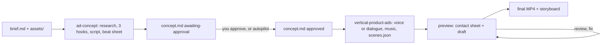

# vertical-product-ads

Two agent skills for **9:16 product ads** (TikTok, Instagram Reels, YouTube Shorts, e-commerce and
beauty/skincare promos). Indonesian version: [README.id.md](README.id.md).

| Skill | Does |
|---|---|
| `ad-concept` | Reads your brief and assets, researches the product, proposes 3 hooks, writes the script and a beat sheet into `concept.md`, and waits for your approval |
| `vertical-product-ads` | Builds the approved concept into a mastered, platform-safe MP4: one `scenes.json`, a pure `seek(t)` engine, a measured audio pipeline |

Works with any agent that reads `SKILL.md` skills: Claude Code, Codex, Cursor, Amp, Cline and others.

## Install
```bash
npx skills add tomimandalaputra/vertical-product-ads                          # pick skills + agents interactively
npx skills add tomimandalaputra/vertical-product-ads --skill '*' -y           # both skills, no prompts
npx skills add tomimandalaputra/vertical-product-ads --skill ad-concept       # one of them
npx skills add tomimandalaputra/vertical-product-ads --skill vertical-product-ads
```
The skills land in your agent's folder: `.claude/skills/` for Claude Code, `.agents/skills/` for
Codex and most others (the installer prints the path). Run the setup check once from the installed
production skill folder (it installs Playwright's Chromium and a numpy venv when missing):
```bash
.agents/skills/vertical-product-ads/scripts/check_setup.sh                # core
.agents/skills/vertical-product-ads/scripts/check_setup.sh --with edge    # + free voice-over (edge-tts)
.agents/skills/vertical-product-ads/scripts/check_setup.sh --with whisper # + local transcription (faster-whisper)
.agents/skills/vertical-product-ads/scripts/check_setup.sh --with all
```

## The flow

`vertical-product-ads` will not start without an approved `concept.md`.

## Checkpoint or autopilot
- **Checkpoint (default):** the agent asks everything missing in one message, writes the concept,
  then stops and shows you 3 hooks. You approve (or edit), then it builds.
- **Autopilot:** it assumes what is missing, picks the hook, and builds in one run. Every
  assumption and decision is logged in `concept.md` and the report.

Example prompts:
> Make a 30-second TikTok ad for this serum. Brief: `my-ad/brief.md`, photos in `my-ad/assets/`.
> Female Indonesian voice-over.

> Autopilot: make a Reels ad for `my-ad/`, ugc style with my footage, free voice and music.

Set `mode: autopilot` in `brief.md` instead of saying it in the prompt if you prefer.

## What to prepare
Copy [`skills/ad-concept/templates/brief.md`](skills/ad-concept/templates/brief.md) to
`my-ad/brief.md`, fill it in, and put files in `my-ad/assets/`. Checklist (full specs:
[`skills/ad-concept/references/intake.md`](skills/ad-concept/references/intake.md)):
- [ ] Product photos: ≥ 3 angles, ≥ 2000 px short side, white or transparent, no baked-in text
- [ ] Product name, variants, price, where to buy
- [ ] Claims, each with its source
- [ ] Objective and the exact CTA
- [ ] Audience and platform
- [ ] Logo, brand colours, font (recommended)
- [ ] Texture/application close-ups (recommended); real before/after and real reviews, only if real
- [ ] For `ugc`/`hybrid`: creator footage 9:16 1080×1920, 30 fps, clean audio, no music, talent release

## Styles
| Style | Looks like | Needs |
|---|---|---|
| `motion` (default) | One rounded shape morphing between photos, cards, text and CTA | Product photos |
| `ugc` | A creator talks; footage leads; word-by-word captions | Footage with speech |
| `hybrid` | Creator hook, then product cards, proof and CTA in the motion look | Footage + photos |

**Switch** by setting `style:` in `brief.md` or saying it in the prompt ("make it hybrid"). The
agent updates `concept.md`, and in checkpoint mode asks you to approve again. Not supported:
avatar or AI-generated presenters, live-action direction. B-roll (footage without speech) is
muted. The agent cannot watch videos; it works from transcripts and stills. Details:
[`skills/ad-concept/references/styles.md`](skills/ad-concept/references/styles.md).

## Free vs ElevenLabs
| Part | ElevenLabs | Free | Licence note |
|---|---|---|---|
| Voice-over | `vo.engine: "elevenlabs"` | `vo.engine: "edge"` (edge-tts) | edge-tts is an unofficial client of Microsoft's Edge read-aloud service; terms for paid ads are unclear: drafts, or accept the risk. ElevenLabs: per your plan's terms |
| Music | `music.prompt` | `music.synth` (local procedural bed) | Synth is generated on your machine: yours. A licensed file also works |
| Transcription (footage) | `dialogue.transcriber: "elevenlabs"` | `"whisper"` (faster-whisper, offline) | Local, no upload |

No ElevenLabs key is needed for a full ad. Put a key in `ELEVENLABS_API_KEY` or a `.env` in the
project or a parent folder to use it.

## Duration
Default 30 s; 15–60 s allowed; over 34 s warns and needs a reason; over 60 s is refused. The hook is
inside the first 3 s; the CTA holds 3–5 s. TikTok 30 s, Reels 30 s plus an optional 15 s cutdown
built as its own project, Shorts 30 s. The 21–34 s (TikTok) and under-15 s (Meta) figures come from
secondary sources, see
[`skills/ad-concept/references/duration-and-platforms.md`](skills/ad-concept/references/duration-and-platforms.md).

## What you get
- **One shape, never cut** in motion scenes: it morphs into cards, circles, three bands, full bleed.
- **Voice and music locked together:** per-word timings; each sentence placed so its key word lands
  on the music's measured beat; text appears on the word that names it.
- **Synthesized sound design** in the song's key; music ducks under speech; mastered −14 LUFS / −1 dBTP.
- **Platform safe zones and layout enforced:** every visible word, caption, chip and the CTA inside
  x 84–930, y 250–1460; no overlapping text; no empty band. Checked at every frame; the build
  fails otherwise.
- **Real motion blur:** 4 subframes per frame at a 180° shutter, 30 fps by default.
- **A review step built in:** beat contact sheet and a half-size draft with sound before the final.

## Try it without any API key
```bash
SKILL=.agents/skills/vertical-product-ads
cp -r $SKILL/examples/minimal my-ad
$SKILL/scripts/make.sh my-ad preview              # contact sheet + draft
$SKILL/scripts/make.sh my-ad final my-ad/out.mp4  # mastered MP4 + storyboard
```

## Measured speed
Apple M3 Pro, 31 s film at 1080×1920. The "Before" column is the same film built with a
hand-written HTML film and a 60 fps renderer.

| | Before | This skill |
|---|---|---|
| Picture render | 219 s (7,440 subframes) | 71 s (3,720 subframes, 30 fps / 180°) |
| Master | 35 s (re-encodes video) | ~5 s (audio only) |
| Draft with sound | none | 12 s |
| Writing the film | a ~600-line JS file per ad | a `scenes.json` per ad |

How each number is obtained: `skills/vertical-product-ads/references/render-and-qa.md`. These were
measured on `motion` films; footage styles have not been timed.

## Requirements
| Need | For |
|---|---|
| Node ≥ 20 (+ `npm install` in the skill: Playwright, Ajv) | engine, render, gates |
| ffmpeg / ffprobe | motion blur, encode, loudness, footage frames |
| Python 3.9+ with numpy | beat grid, SFX and music synthesis, mix |
| `edge-tts` (`--with edge`) | free voice-over; needs network |
| `faster-whisper` (`--with whisper`) | offline transcription of footage |
| `ELEVENLABS_API_KEY` (optional) | ElevenLabs voice-over, music, transcription |

## Layout
| Path | |
|---|---|
| `skills/ad-concept/` | `SKILL.md`, `references/` (intake, hooks, styles, scene menu, durations), `templates/` (`brief.md`, `concept.md`) |
| `skills/vertical-product-ads/SKILL.md` | what the production agent follows |
| `skills/vertical-product-ads/references/` | direction, styles, `scenes.json` format, VO/beat sync, safe zones, render + QA |
| `skills/vertical-product-ads/engine/` | `index.html` + `engine.js`: the pure `seek(t)` renderer |
| `skills/vertical-product-ads/scripts/` | `make.sh` (preview/final) and every step it runs |
| `skills/vertical-product-ads/schemas/scenes.schema.json` | the contract `validate.mjs` enforces |
| `skills/vertical-product-ads/examples/minimal/` | an asset-free 8.5 s film |

## Licence
MIT, see `LICENSE`. Portions are derived from
[product-launch-motion](https://github.com/AbubakrChan/product-launch-motion) (MIT); see `NOTICE`.
Product images, footage, voices and music you put into a film keep their own licences.
