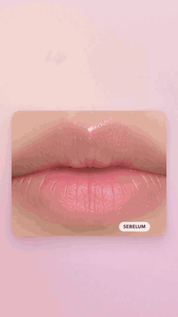
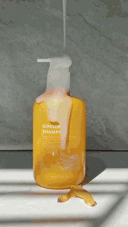
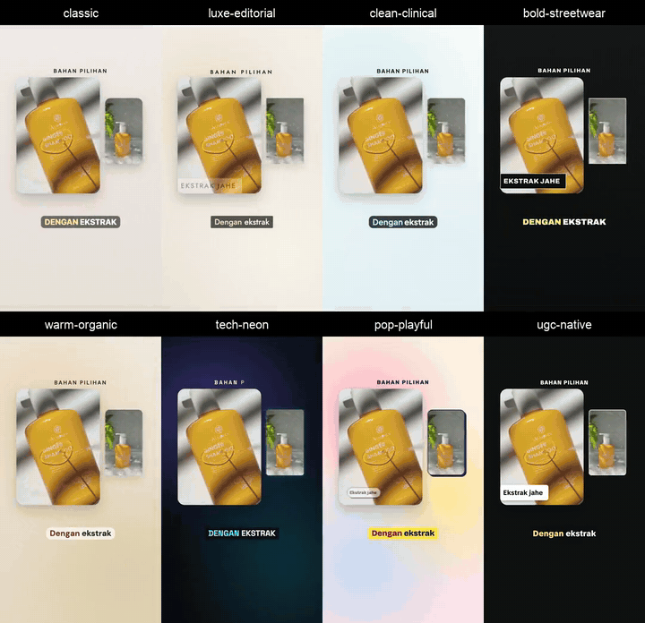
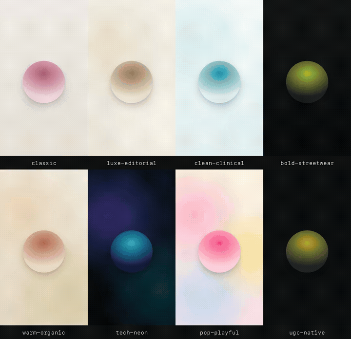
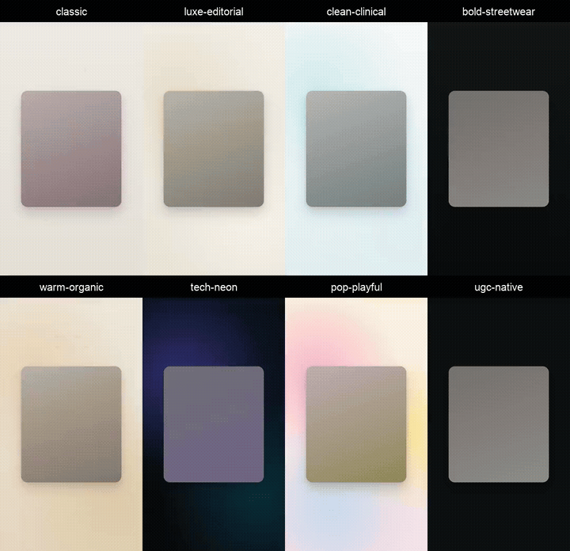

# Galeri

[Beranda](../README.id.md) · [English](showcase.md) · [Panduan penggunaan](guide.id.md)

[Contoh iklan](#contoh-iklan) · [Look dan layout](#look-dan-layout) · [Kredit](#kredit)

Pratinjau GIF tidak bersuara. Klik gambar untuk membuka MP4 dengan voice-over bahasa Indonesia.
Media contoh ini untuk demonstrasi, bukan stok yang boleh dipakai ulang; lihat [kredit](#kredit).

## Contoh iklan

| Motion: Dior Addict Lip Glow | Hybrid: sampo jahe |
|---|---|
|  |  |
| 31 detik. Gambar produk dan model buatan AI, teks animasi, serta bingkai produk yang berubah bentuk. Spec ad tidak resmi. | 20 detik. B-roll kreator yang dibisukan, lalu diberi voice-over, musik, dan motion graphics. |

Keduanya memakai voice dan musik ElevenLabs; film sampo juga memakai efek suara ElevenLabs.
Edit sampo adalah **hybrid**, bukan dialog kreator. Versi siap pakai dengan merek fiktif tersedia
di [contoh product-broll](../skills/vertical-product-ads/examples/product-broll/);
footage sumber tidak disertakan.

## Look dan layout

**Gaya** menentukan cara iklan memakai foto, footage, dan suara. **Look** mengatur font, warna,
caption, dan perlakuan visual. **Layout** menyusun gambar dan teks dalam tiap adegan.
Semua delapan look bisa dipakai untuk motion, UGC, dan hybrid.

### Footage kreator dalam delapan look

Satu edit 20,2 detik, dirender delapan kali dengan perubahan hanya pada `look`. Layout mencakup
picture-in-picture, split screen, kolase polaroid di bawah teks berjalan, serta callout volume
pada end card. Identitas produk dan klaim yang bersumber dari label tetap dipertahankan.

GIF dimulai pada detik ke-5 agar fokus ke layout; MP4 berisi film lengkap dengan suara.
Ini b-roll kreator berizin dengan narasi ElevenLabs, bukan demo kreator berbicara atau lip-sync.

### Look tanpa foto produk

Iklan serum bibir fiktif 17 detik yang sama, dengan teks animasi, angka berputar, tiga panel shade,
dan end card. Hanya `look` yang berubah. Proyek memakai bidang warna, bukan foto produk.

Coba [proyek look-sampler](../skills/vertical-product-ads/examples/look-sampler/).

| Look | Umumnya untuk | Font |
|---|---|---|
| `classic`, bawaan | Iklan produk umum | Georgia + sans sistem |
| `luxe-editorial` | Parfum, perhiasan, kecantikan premium | Bodoni Moda + Jost |
| `clean-clinical` | Skincare dan apotek | Plus Jakarta Sans |
| `bold-streetwear` | Sneakers, streetwear, fitness | Anton + Archivo |
| `warm-organic` | Herbal, makanan, perawatan rambut dan tubuh | Fraunces + DM Sans |
| `tech-neon` | Gadget, audio, aplikasi | Space Grotesk + JetBrains Mono |
| `pop-playful` | Snack, mainan, kecantikan Gen-Z | Bricolage Grotesque + Rubik |
| `ugc-native` | Iklan yang berfokus pada kreator | TikTok Sans |

Font look selain classic disertakan dengan SIL Open Font License. Tiap look juga menentukan
cara teks muncul dan arahan tempo, musik, serta efek suara.
[Panduan look](../skills/ad-concept/references/looks.md) ·
[Arahan produksi](../skills/vertical-product-ads/references/looks.md)

### Demo layout

Demo serum fiktif 20 detik: teks kinetik, split screen, teks berisi gambar, callout produk,
baris perbandingan, grid yang berubah menjadi kolase di bawah teks berjalan, serta ponsel berisi
halaman toko. Botol dan halaman toko adalah gambar SVG, bukan foto produk hasil generator AI.

Coba [proyek layout-sampler](../skills/vertical-product-ads/examples/layout-sampler/).

| Layout | Kegunaan |
|---|---|
| Split screen | Perbandingan yang didukung bukti atau dua sudut produk |
| Grid dan kolase | Varian, paket, foto keseharian, atau b-roll |
| Picture-in-picture | Suara kreator di atas b-roll, atau detail produk pendukung |
| Tumpukan kartu | Fitur atau ulasan asli, satu per satu |
| Ponsel | Screenshot toko atau rekaman layar |
| Teks berisi gambar | Gambar atau footage di dalam huruf besar |
| Callout | Titik dan label yang menunjukkan fitur produk |
| Daftar perbandingan | Baris centang sesuai timing, dengan kolom opsional |
| Teks berjalan | Teks promosi yang bergerak |
| Teks kinetik dan grid editorial | Kata-kata saja, atau gambar besar dipasangkan dengan gambar kecil |

Agen konsep biasanya memilih dua sampai empat layout per film. Perbandingan dan ulasan perlu
bahan pendukung asli; demo layout bukan bukti klaim produk.
[Resep dan aturan layout](../skills/vertical-product-ads/references/layouts.md).

## Kredit

| Media | Sumber dan ketentuan |
|---|---|
| `dior-lip-glow.*` | Spec ad tidak resmi, tidak berafiliasi, disponsori, atau didukung Christian Dior. Gambar dibuat dengan AI. Merek Dior dan Addict Lip Glow milik pemiliknya; klaim hidrasi 48 jam dan footnote berasal dari halaman produk Dior. Audio ElevenLabs mengikuti paket pemilik repo. |
| `ginger-shampoo.*`, `ugc-layouts.*` | Footage oleh [@hanie.ugc.creator](https://www.tiktok.com/@hanie.ugc.creator/video/7467561053971369223), dipakai dengan izin. Produk dan merek milik pemiliknya; klaim dan volume berasal dari kemasan. Musik footage asli dibisukan; narasi, musik, dan efek memakai audio ElevenLabs yang sudah ada. |
| `looks.*`, `layouts.*` | Produk dan klaim fiktif. Musik sintesis lokal; suara edge-tts, yang ketentuan penggunaan komersialnya belum jelas. Contoh layout menyertakan dua gambar SVG. |

File ini berada di `media/` pada root repo, di luar skill yang terpasang, dan **tidak termasuk
lisensi MIT skill**. Atribusi lengkap dan lisensi font: [NOTICE](../NOTICE).
