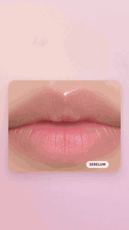
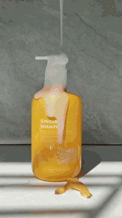
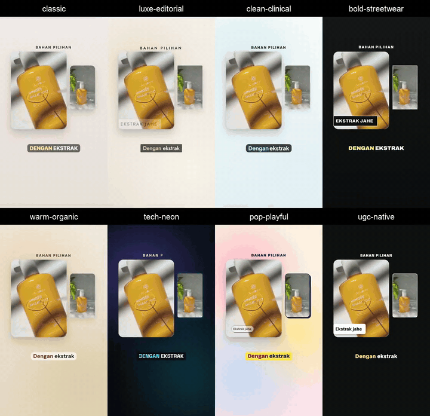
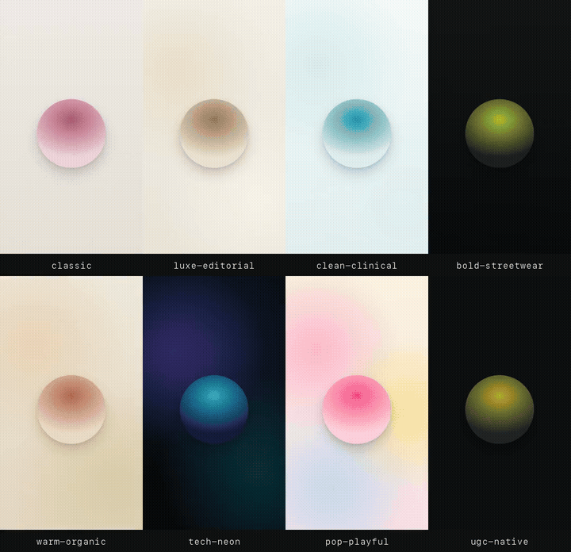
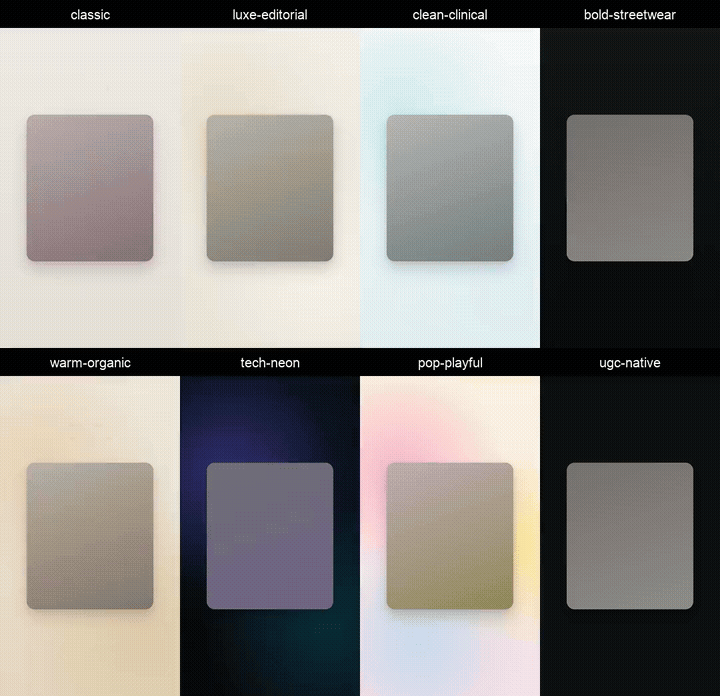

# Gallery

[Home](../README.md) · [Bahasa Indonesia](showcase.id.md) · [User guide](guide.md)

[Finished ads](#finished-ads) · [Looks and layouts](#looks-and-layouts) · [Credits](#credits)

GIF previews are silent. Click an image to open its MP4 with Indonesian voice-over.
Showcase media is for demonstration, not reusable stock; see [credits](#credits).

## Finished ads

| Motion: Dior Addict Lip Glow | Hybrid: ginger shampoo |
|---|---|
|  |  |
| 31 s. AI-generated product and model images, animated text and a morphing product frame. Unofficial spec ad. | 20 s. Muted creator-shot b-roll with voice-over, music and motion graphics. |

Both use ElevenLabs voice and music; the shampoo film also uses ElevenLabs sound effects.
The shampoo edit is **hybrid**, not creator dialogue. A reusable version with a fictional brand
is in [the product-broll example](../skills/vertical-product-ads/examples/product-broll/);
source footage is not included.

## Looks and layouts

A **style** decides how the ad uses photos, footage and speech. A **look** sets the fonts,
colours, captions and visual treatment. A **layout** arranges the pictures and text within a scene.
All eight looks work with motion, UGC and hybrid styles.

### Creator footage in eight looks

One 20.2-second edit, rendered eight times with only `look` changing. The layouts are
picture-in-picture, split screen, a polaroid collage under a marquee, and a volume callout on the
end card. Original product identity and label-sourced claims remain intact.

The GIF starts at film second 5 to focus on layouts; the MP4 includes the full film with sound.
This is permitted creator-shot b-roll with ElevenLabs narration, not a talking-head or lip-sync demo.

### Looks with no product photos

The same 17-second fictional lip-serum ad, with animated type, a rolling number, three shade bands
and an end card. Only `look` changes. The project uses fills rather than product images.

Try the [look-sampler project](../skills/vertical-product-ads/examples/look-sampler/).

| Look | Typical use | Typography |
|---|---|---|
| `classic`, default | General product ads | Georgia + system sans |
| `luxe-editorial` | Fragrance, jewellery, premium beauty | Bodoni Moda + Jost |
| `clean-clinical` | Skincare and pharmacy | Plus Jakarta Sans |
| `bold-streetwear` | Sneakers, streetwear, fitness | Anton + Archivo |
| `warm-organic` | Herbal products, food, hair and body care | Fraunces + DM Sans |
| `tech-neon` | Gadgets, audio, apps | Space Grotesk + JetBrains Mono |
| `pop-playful` | Snacks, toys, Gen-Z beauty | Bricolage Grotesque + Rubik |
| `ugc-native` | Creator-led ads | TikTok Sans |

The non-classic look fonts are bundled under the SIL Open Font License. The look also defines
text entrances and direction for pace, music and sound.
[Look guide](../skills/ad-concept/references/looks.md) ·
[Production direction](../skills/vertical-product-ads/references/looks.md)

### Layout sampler

A 20-second fictional serum demo: kinetic type, split screen, text mask, product callouts,
comparison rows, a grid turning into a collage under a marquee, and a phone with a shop page.
The bottle and shop page are SVG drawings, not generated product photos.

Try the [layout-sampler project](../skills/vertical-product-ads/examples/layout-sampler/).

| Layout | Use |
|---|---|
| Split screen | Supported comparisons or two product views |
| Grid and collage | Variants, bundles, lifestyle pictures or b-roll |
| Picture-in-picture | Creator speech over b-roll, or a supporting product detail |
| Card stack | Features or real reviews, one at a time |
| Phone | Shop screenshot or screen recording |
| Text mask | A picture or footage inside large letters |
| Callouts | Points and labels identifying product features |
| Comparison list | Timed check rows, with optional columns |
| Marquee | Running promotional text |
| Kinetic type and editorial grid | Words alone, or a large image paired with a smaller one |

The concept agent normally chooses two to four layouts per film. Comparisons and reviews need
real supporting material; a demo layout is not evidence of a product claim.
[Layout recipes and rules](../skills/vertical-product-ads/references/layouts.md).

## Credits

| Media | Source and terms |
|---|---|
| `dior-lip-glow.*` | Unofficial spec ad, not affiliated with, sponsored or endorsed by Christian Dior. Images are AI-generated. Dior and Addict Lip Glow marks belong to their owner; the 48-hour hydration claim and footnote come from Dior's product page. ElevenLabs audio follows the repository owner's plan. |
| `ginger-shampoo.*`, `ugc-layouts.*` | Footage by [@hanie.ugc.creator](https://www.tiktok.com/@hanie.ugc.creator/video/7467561053971369223), used with permission. Product and marks belong to their owner; claims and volume come from the packaging. Original footage music is muted; narration, music and effects use the existing ElevenLabs audio. |
| `looks.*`, `layouts.*` | Fictional products and claims. Local synthesized music; edge-tts voice, whose commercial-reuse terms are unclear. The layout example includes two SVG drawings. |

These files live in repository-root `media/`, outside the installed skills, and are **not covered
by the skills' MIT licence**. Full attribution and font licences: [NOTICE](../NOTICE).
